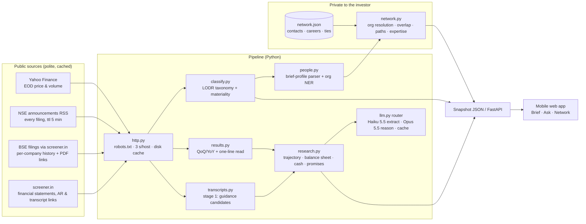

# FINN — Financial Investment Agent

A mobile-first agent for a public-markets investor. It reads every filing across the portfolio,
tells you the few that matter and why, digs into any company from its primary sources, and tells
you **who in your own network can help you understand it**.

- **Push · Brief**: a windowed digest (24h to 30 days) of every exchange filing across 19 holdings. Each
  one is triaged into *needs you*, *worth a glance* and *buried*, with type-specific cards, configurable
  price/volume alerts and a results-season heatmap.
- **Pull · Ask**: research on any NSE ticker, built only from filed financials and concall transcripts.
  It includes a *promised vs delivered* audit of management's last four calls.
- **Network**: your contacts as an intelligence layer. It shows up as a violet thread inside Push and
  Pull cards ("your way in", "best person to call", "who'd know why"), and can also be queried directly:
  expertise map, reasons to reconnect, a network map.

**Live demo (phone-friendly):** https://claude.ai/artifact/Dfh6QNxQofXTVbhyLEroLq · static snapshot as of 16 Nov 2026.
Run the FastAPI server locally for live research on any NSE ticker.

> Everything in the demo is real market data as of **16 Nov 2026**: prices, 95 filings, financial
> statements and ~120 concall transcripts for 23 companies. The one exception is the investor's
> network, which is synthetic (see [Data provenance](#data-provenance)).

---

## Point of view: a brief, not a feed

An investor doesn't need another feed. FINN behaves like a sharp analyst who has already read everything:

1. **It shows its judgment.** The brief opens with one sentence ("3 things need you out of 14 filings")
   and a triage bar showing how much was buried. Every card has a *Why this?* that explains the score.
   Routine filings (investor-meet notices, newspaper ads, ESOP allotments, RTA address changes) are counted
   and folded away, not deleted.
2. **Each type of event gets the card it deserves.**
   - *Management change*: who the person is (from the filing itself), then **your way in**, a path from you
     through a contact to them with the evidence and its strength, then three questions worth asking.
   - *Results*: Revenue / EBITDA / PBT / PAT, QoQ and YoY, the margin move in bps, and one deterministic
     line that names the single most important fact ("EBITDA margin compressed 1521 bps YoY to 14%, the
     lowest in 9 quarters").
   - *Material event* (M&A, litigation, capex): the key facts pulled from the PDF ("unit contributes ~2.5%
     of revenue", "returnable 19 Nov") and the best person to call, with what they would know.
   - Everything else is a one-liner at the right priority.
3. **You set what "unusual" means.** The volume multiple, price move and followed categories are sliders
   and toggles. The brief re-ranks instantly.
4. **The network is woven in, not bolted on.** Violet always means *someone you know*. It appears wherever
   a person could shortcut your understanding, and the Network tab is where you go to browse it.

### Workflows that run end to end on real data

| Real event (filed) | What FINN shows |
|---|---|
| **Equitas SFB** appoints a Chief Risk Officer (16 Nov) | Bio from the filing's SEBI-mandated *brief profile* (25 yrs, ex-CRO Punjab & Sind Bank, FRM, CAIIB). It is matched against your network and finds **Rohit Bansal, ex-Chief Credit Officer at Punjab & Sind Bank**, labelled *possible overlap* because the filing gives no dates. |
| **Subex** CFO resigns (16 Nov) | Scored 95 ("CFO resignations are the classic early-warning signal"). No incoming person yet, so FINN points to **who'd know why**: your contact who ran Subex's monthly close for six years. |
| **CG Power** gets a pollution-board closure order, stayed by the High Court | Facts from the PDF (the unit is ~2.5% of revenue, hearing returnable 19 Nov). Best person to call: **the contact who ran that exact Waluj plant**, ranked first because the event text names the plant. |
| **Kaynes** results + JV with Toyokawa Techno for TFT modules | Results card (revenue +4.5%, margin a 9-quarter low, PAT −66%), the JV as M&A, and a former Kaynes display-programme manager to call. |
| **Aarti Industries** promoter passes away | Succession-and-control framing, plus the contact who worked with the founding family for a decade. |
| **PI Industries** / **Kaynes** research | Promised vs delivered. Kaynes guided FY26 at ₹4,500 cr, cut it to ₹4,000 cr, and delivered ₹3,626 cr. An analyst on the May call asks about the "sanctity of guidance". |

---

## Architecture



### Data pipelines
- **Prices**: one batched `yfinance` call for all `.NS` tickers at end of day. Thresholds are applied
  client-side so changing a slider needs no round trip.
- **Filings**: two exchange-originated sources, normalised to one schema and de-duplicated on
  *(company, day, category or fuzzy text)*. The same filing arrives from NSE and BSE with different wording.
  - **NSE RSS** is the low-latency push trigger; in production it's polled every 5 minutes.
  - **BSE (via screener.in)** gives per-company history from day one.
  - BSE's own JSON API refuses automated clients. FINN does not work around that; the writeup says how
    I'd license the feed for real.
- **Fundamentals**: screener.in's standardised statements (quarterly, annual, balance sheet, cash flow,
  efficiency ratios, shareholding) plus links to annual reports and transcripts (BSE-hosted PDFs). Parsing
  is label-driven, so banks (Revenue / Financing Profit, no EBITDA) work too. For banks, FINN shows NII
  in place of EBITDA.
- **People**: the name in a filing comes with a profile written by the company, because SEBI LODR
  Schedule III requires a *brief profile* for every appointed director or KMP. FINN parses employers and
  institutions out of it with dictionary NER against an org registry with aliases, then fuzzy-matches
  organisations conservatively (≥90). Contact-to-person links are **inferred from career overlap** and
  always labelled with their evidence.
- **Link strength is sceptical by design.** It weighs years overlapped, seniority and company size:
  overlapping at a 3,000-person firm counts, overlapping at a 300,000-person firm barely does. When one
  side's dates are unknown, the link is marked *possible*. Tie strength (you to a contact) comes from the
  recency and frequency of interaction.
- **Refresh**: `scripts/build_snapshot.py` runs the whole pipeline. It takes about 6 minutes cold and
  seconds warm, because filings and transcripts are immutable and cached forever. In production: the RSS
  poller runs every 5 minutes, prices and fundamentals at end of day, and research is computed on demand
  and cached per *(ticker, latest call)*.

### Use of LLMs and agents
FINN is mostly deterministic. The model is the exception, used only where reasoning pays for itself:

| Step | How | Model | Why |
|---|---|---|---|
| Filing classification & scoring | rules over the LODR subject line + text cues (role seniority, rupee amount vs market cap) | none | about 95% of subjects are unambiguous; free and instant |
| Residual classification, one-line summaries, profile extraction when NER finds nothing | structured JSON output | **Claude Haiku 5.5** (`extract` tier) | bulk, cheap ($0.10 / $0.50 per MTok), cached per subject or filing |
| Guidance extraction | **stage 1 is free**: speaker segmentation keeps management turns and scores sentences for forward-looking and quantified. A 50-page transcript becomes ~10 lines, **~98% fewer tokens** | Haiku 5.5 optional | cost |
| Promised vs delivered, bull/bear | verbatim quotes + reported numbers only; JSON schema output | **Claude Opus 5.5** (`reason` tier), server-side refusal fallback | needs judgment: telling a promise from a past fact, gross vs EBITDA margin, revised guidance |

Every model call goes through `finn/llm.py`, which handles four things:
- **Caching**: each result is keyed by a semantic key (`task:symbol:call`) plus a prompt hash.
- **Prompt caching**: the system prompts stay stable so they can be cached.
- **Spend ledger**: every call's token usage is written to `_ledger.jsonl`.
- **Opt-in**: calls only happen when `FINN_ANTHROPIC_API_KEY` is set, so the app never picks up ambient
  credentials. With no key, every view still works on its rules-only path.

**Agents:** there are no autonomous agents in the prototype. The flows are fixed pipelines with model
steps, which is cheaper, testable and predictable. The one place an agent earns its keep is Ask. Next step:
a tool-using research agent with read-only tools (`fetch_company`, `transcript_search`, `who_to_call`)
that plans multi-hop questions ("which of my holdings have a CFO who joined from a Big-4 firm in the last
two years, and who do I know there?").

**What the demo actually contains:**
- No API key was available while building, so the reasoning-tier outputs for **PI Industries and Kaynes**
  were written in the build session (by Claude, the coding agent) from the same extracted inputs the
  pipeline would send.
- They are stored in `data/llm_cache/` with that provenance stated. All the numbers were checked against
  the filed tables.
- Every other company shows the rules-only pass, which the UI labels. Add a key and the router fills the
  cache for any ticker.

### Data security & privacy
- **The network is the investor's data, not FINN's.** It lives in a per-user, encrypted store and is
  never sent to a model by default: network matching is deterministic code. If a model ever sees contact
  data, it gets pseudonymous IDs.
- **What's stored and for how long.**
  - *Contacts*: what the investor imports (name, employers, years, education, how met) plus interaction
    metadata (date and count only, never message content), kept until the investor deletes them.
  - *People in filings*: only what the company itself published in the filing, kept with a source link.
  - *Derived links*: recomputed, not stored.
  - *Inferred links* are labelled and never presented as fact.
- **Consent.** Contacts come from the investor's own exports (address book, CRM, calendar), with
  per-source toggles. Real profile enrichment would use a licensed provider or an official API (a LinkedIn
  partner programme, or a people-data vendor under contract), never scraping. Contacts can be excluded
  from enrichment entirely.
- **Access control.** Single-tenant per investor, with SSO (OIDC) and row-level security keyed on
  `owner_id`. Team sharing is an explicit, per-contact opt-in, so a PM's network never leaks to the desk
  by default. There is an audit log of who viewed which contact.
- **Model providers.** Zero-data-retention terms, no training on inputs, and filings and transcripts are
  public anyway.
- **Prototype.** The network file is synthetic, ships in the repo, and nothing personal leaves the device.

### Cloud services (production sketch)
| What | Where | Why |
|---|---|---|
| Pollers (NSE RSS 5-min, EOD prices/fundamentals) | Cloud Run jobs + Cloud Scheduler | serverless, pennies a month, idempotent |
| Filings, prices, research cache | Postgres (Cloud SQL) + object storage for PDFs and text | relational joins (filing to company to person); PDFs immutable |
| Network store | separate Postgres schema with RLS, CMEK-encrypted | blast-radius isolation for the only personal data |
| API | FastAPI on Cloud Run, behind IAP/SSO | scales to zero; one container |
| Push notifications | FCM / APNs from the scoring step (score ≥ 75 or a threshold hit) | the "push" in Push |
| Models | Anthropic API (Haiku 5.5 / Opus 5.5) via the router | routing + caching keep cost to cents per day |

### Cost
- **The prototype costs ₹0.** Every source is free and public, and there were no model calls (no key).
- **With a key, roughly:**
  - Haiku on ~50 material filings a day is about 50 × 3k tokens ≈ $0.02/day.
  - Opus for promised-vs-delivered on ~20 results a day is about 20 × 6k tokens in and 1.5k out
    ≈ $1/day, and each company is computed once per quarter thanks to the cache.

---

## Run it

```bash
python -m venv .venv && . .venv/bin/activate
pip install -r requirements.txt
python scripts/build_snapshot.py        # fetch + compute (≈6 min cold, cached afterwards)
python scripts/make_index.py
uvicorn finn.api:app --port 8000        # open http://localhost:8000 on your phone (same Wi-Fi) or browser
```

- **Static mode**: `web/` is a self-contained static site, so any static host works, and the app runs
  entirely from `web/data/`.
- **Live mode**: when the FastAPI server is running, *Ask* accepts any NSE ticker and does live research
  in about 20 s, then caches it.
- **Optional**: set `export FINN_ANTHROPIC_API_KEY=...` to turn on the model tiers.

## Data provenance
| Data | Source | Real? |
|---|---|---|
| Prices & volume | Yahoo Finance (yfinance) | real |
| Filings | NSE announcements RSS; BSE filings via screener.in | real |
| Financial statements, transcripts, annual reports | screener.in tables; BSE-hosted PDFs | real |
| Bios of people in filings | the filing's own *brief profile* | real (primary source) |
| Investor's network (30 people, private firms) | **synthetic**, written for the demo; listed companies are real, people and private firms are fictional | synthetic |
| Reasoning-tier outputs for PIIND, KAYNES | written in the build session from the extracted inputs (see above) | model-generated, cached |

## Deliberately left out
- **Exchange-licensed real-time feeds.** The RSS feed and EOD data are enough to prove the loop.
- **A chat interface.** Ask routes intents (ticker, person, theme) without one. Chat is the obvious next
  step, but a good brief beats a chatbot for the daily workflow.
- **Segment-level revenue mix.** Screener doesn't expose it. It needs annual-report parsing (MD&A tables)
  with the extract tier.
- **Real push notifications, auth, multi-user.** Described above, not built.
- **Gross-margin checks.** They need the results PDF's line items. FINN marks them *unverifiable* rather
  than guessing.

## Where I'd take it next
1. **Results-day autopilot.** When a results PDF lands, run cheap-model extraction of the line items,
   reconcile them against the standardised table (two-source check), compare against the last call's
   guidance, and push within minutes.
2. **Second-degree via the contacts' own networks** (with their consent), plus a "draft the intro" action
   in the person card.
3. **A tool-using research agent** for multi-hop questions across the portfolio and the network.
4. **Feedback loop.** Swiping *not useful* on a card retrains the materiality weights per investor.

## Repository map
```
finn/data/      http (polite cache) · prices · filings · screener
finn/intel/     classify · results · people · network · transcripts · research
finn/push.py    brief builder (scoring + type-specific enrichment)
finn/llm.py     model router + cache + prompts/schemas
finn/api.py     FastAPI: live research for any ticker + serves the app
web/            the mobile app (vanilla JS, no build step) + data/ snapshot
data/network/   synthetic network
data/llm_cache/ cached model outputs (with provenance)
scripts/        build_snapshot.py · make_index.py
docs/           WRITEUP.md (covering note) · BUILD_LOG.md (how this was built with an AI agent)
```
